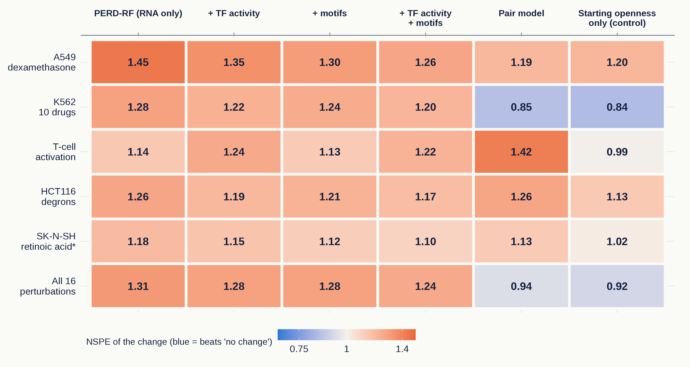

# Can RNA predict how a drug changes enhancer accessibility?

A measured validation of PERD, and two attempts to improve it. Final project for *Multimodal AI in Therapeutic
Discovery* (Yusuf Maulana, 200010279).

[PERD](https://doi.org/10.1038/s41540-024-00388-8) (Wang & Wang, 2024) predicts how open each enhancer is from the RNA
of its target genes and of the transcription factors (TFs) bound in it. Its authors used it on drug-treated RNA to
call "drug-responsive" enhancers, but those calls were never compared with measured accessibility. I tested PERD on
16 ENCODE perturbations (40 before/after pairs where both RNA and accessibility were measured) and asked four
questions:

| Question | Answer |
|---|---|
| 1. Is PERD a good model of openness in tissues it never saw? | **Yes.** Holding out whole tissues lowers its median per-enhancer correlation only from 0.50 to 0.46. |
| 2. Does it predict real drug-induced changes? | **No.** It predicts openness before and after treatment well (NSPE 0.31–0.57), but the change is predicted worse than "no change" in all five datasets (NSPE 1.14–1.45). |
| 3. Do TF activity and motif inputs help? | **On unseen tissues, yes** (NSPE 0.276 → 0.245). For the drug-induced change, barely: still above 1 everywhere. |
| 4. Does training on real perturbations help? | **Only through the starting state.** A model trained on before/after pairs beats "no change" (0.94), but a control that only knows each enhancer's starting openness does as well (0.92). |

NSPE is PERD's normalized squared prediction error: 0 is perfect, 1 is no better than predicting the average (for a
change, that means no better than guessing "no change").



The full write-up is in [`report/report.md`](report/report.md) ([PDF](report/report.pdf)); the talk slides are in
[`report/slides.pdf`](report/slides.pdf).

## Try it: the notebook and toy data

The folder [`demo/`](demo/) has a small toy dataset (150 enhancers and 11 before/after pairs, real values
cut from the full data) and a notebook, [`demo/demo.ipynb`](demo/demo.ipynb), that runs all four
analyses on it. The notebook is saved with its outputs, so you can read the results on GitHub without running
anything. To run it yourself (about 12 minutes on 4 CPUs, plus a few minutes for the first install):

```bash
# 1. Install pixi (https://pixi.sh) once
curl -fsSL https://pixi.sh/install.sh | bash

# 2. Create the environment (Python 3.11, pandas, scikit-learn, Jupyter; Linux or macOS on Apple silicon)
pixi install

# 3. Open the notebook ...
pixi run notebook

# ... or run the same steps as a script; tables go to demo/output/
pixi run demo
```

The toy numbers will not match the report because the data are much smaller; see
[`demo/toy_data/README.md`](demo/toy_data/README.md). `pixi run test` runs the unit tests.

## Repository layout

```
src/perd_perturbation/   library code, with unit tests in tests/
  perd_rf.py               PERD-RF: one random forest per enhancer, fit on ENCODE, predict any RNA profile
  tf_activity.py           TF activity from target genes (univariate linear model, as in decoupleR)
  pair_model.py            inputs of the pair model (one row per enhancer per before/after pair)
  encode_dex.py, atac.py, rna.py   turning ENCODE files into PERD's units
  vendor/perd_repro/       code copied from my PERD reproduction (model settings, openness rule, cell types)
scripts/                 the analysis, one numbered script per step (order below)
scripts/R/               report_figures.R (all report figures), limma_diff.R
demo/                    toy data, demo.ipynb (the notebook), run_demo.py, make_toy_data.py
data/                    manifests of every downloaded file (md5, URL); the data themselves are not committed
results/tables/          the result tables behind the report
report/                  report.md / report.pdf, figures, slides
```

## Reproducing the full analysis

This needs about 100 GB of disk for downloads and a many-core Linux machine: the random-forest steps take hours each
on 32 CPUs, roughly two days of compute in total. Scripts use the number of CPUs in the environment variable
`SLURM_CPUS_PER_TASK` (one CPU if it is not set), so on any machine you can run, for example,
`SLURM_CPUS_PER_TASK=32 pixi run python scripts/11d_tissue_grouped_split.py`.

First get the PERD training tables into `../perd/data/interim/` (see [`DATA.md`](DATA.md)) and install the extra
environments with `pixi install -e bio` (samtools, bedtools, pyBigWig) and `pixi install -e r` (R with limma and
ggplot2). Then run the steps in order from the repository root. Scripts that take an argument say so in their
docstring; run them once per listed value.

| Step | What | Commands |
|---|---|---|
| 1 | Find ENCODE series with RNA and accessibility before and after treatment | `pixi run python scripts/12a_encode_perturbation_survey.py` |
| 2 | A549 + dexamethasone: manifest, download, tables, checks | `pixi run python scripts/09a_encode_dex_manifest.py`; `pixi run -e bio python scripts/09b_encode_dex_download.py`; `pixi run python scripts/09c_encode_dex_capability.py` |
| 3 | K562 drugs and T-cell activation: manifest, download, tables, replicate checks | `pixi run python scripts/13a_k562_tcell_manifests.py`; `pixi run -e bio python scripts/13b_k562_tcell_download.py`; `pixi run python scripts/13c_a06_tables_gates.py` |
| 4 | HCT116 degrons and SK-N-SH retinoic acid | `pixi run python scripts/17b_extension_manifests.py`; `pixi run -e bio python scripts/17c_extension_download.py`; `pixi run python scripts/17d_extension_tables_gates.py` |
| 5 | GR ChIP-seq peaks (used by the motif step) | `pixi run python scripts/11a_encode_gr_peaks.py` |
| 6 | PERD-RF predictions for every perturbation sample | `scripts/09e_encode_dex_predictions.py`, `scripts/13d_a06_predictions.py`, `scripts/17e_extension_predict_evaluate.py` |
| 7 | Q1: tissue-grouped 5-fold cross-validation; shared random forest | `scripts/11d_tissue_grouped_split.py`; `scripts/16b_shared_rf.py` |
| 8 | TF activity (and an optional cross-check against decoupler, see the script's docstring) | `scripts/14a_tf_activity.py`; `scripts/14f_decoupler_crosscheck.py` |
| 9 | Q3: TF activity as inputs, on unseen tissues and on the perturbations; shuffled-target control | `scripts/14b_tfact_predictions.py tfadd`; `scripts/14c_tfact_tissue_split.py tfadd`; `scripts/17a_shuffled_regulon_control.py` |
| 10 | Motif archetypes (download commands in DATA.md); motif inputs on unseen tissues and on the perturbations | `pixi run -e bio python scripts/18a_motif_archetypes.py`; `scripts/19a_motif_activity_heldout.py tfmotif` and `tfboth`; `scripts/21a_variant_perturbation_predictions.py tfadd`, `tfmotif` and `tfboth` |
| 11 | Q4: pair model, leave one perturbation out | `scripts/20a_pair_model_fit.py`; `scripts/20b_pair_model_evaluate.py` |
| 12 | Score every model on all 40 pairs | `scripts/21b_all_models_evaluate.py` |
| 13 | Report figures | `scripts/15e_heldout_violins.py`; `scripts/15f_inputs_heldout_nspe.py`; `pixi run -e r Rscript scripts/R/report_figures.R` |

Commands without an environment run with `pixi run python ...`. `09f`, `09h`, `11b`, `11c`, `13e` and `15b` are
helper scripts that later steps import.

Some docstrings refer to "amendments" and to `execution.md`: I fixed every analysis in a written protocol before
running it and logged each run, in a development branch that is not part of this submission.

## Notes

- The PERD model here is my Python reproduction of the paper, not the authors' R code. It uses a substitute
  TF-binding file because PERD's original one can no longer be downloaded.
- Everything is CPU-only. I did not move the random forests to a GPU library, so that results match scikit-learn.
- Data sources and checksums: [`DATA.md`](DATA.md).

## References

Wang & Wang, *npj Syst Biol Appl* 10, 62 (2024); Zhou et al., *Nat Commun* 8, 1038 (2017); Fishilevich et al.,
*Database* (2017); Müller-Dott et al., *Nucleic Acids Res* 51, 10934 (2023); Badia-i-Mompel et al., *Bioinformatics
Advances* 2, vbac016 (2022); Vierstra et al., *Nature* 583, 729 (2020); ENCODE Project Consortium, *Nature* 583, 699
(2020).
