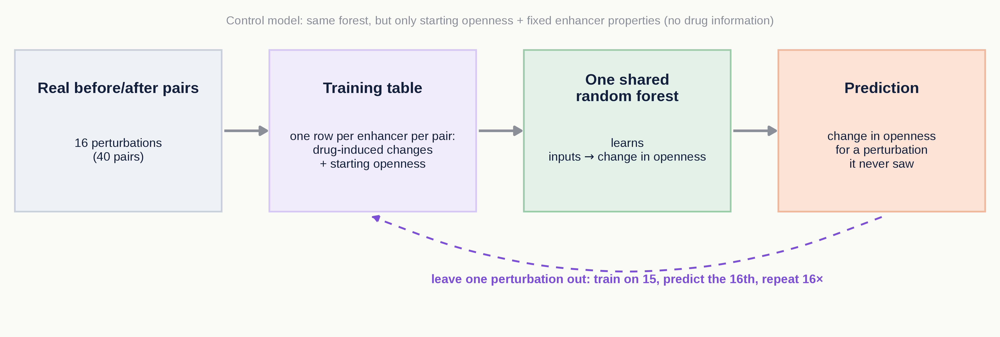
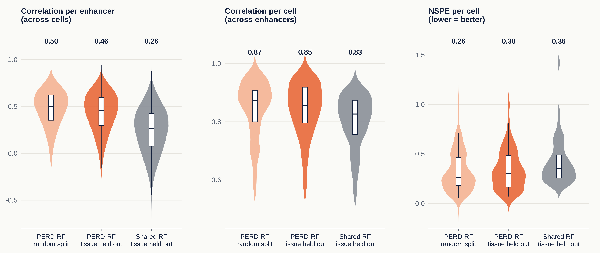
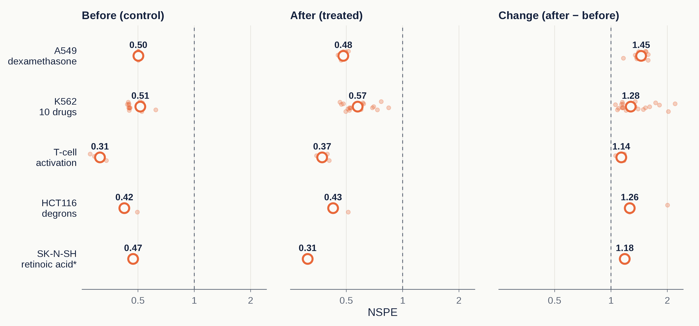
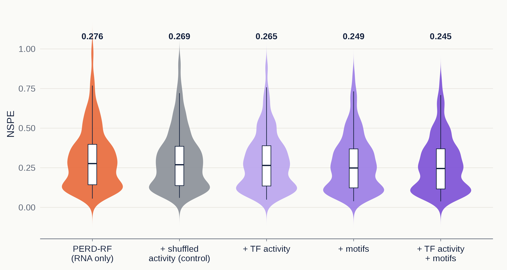
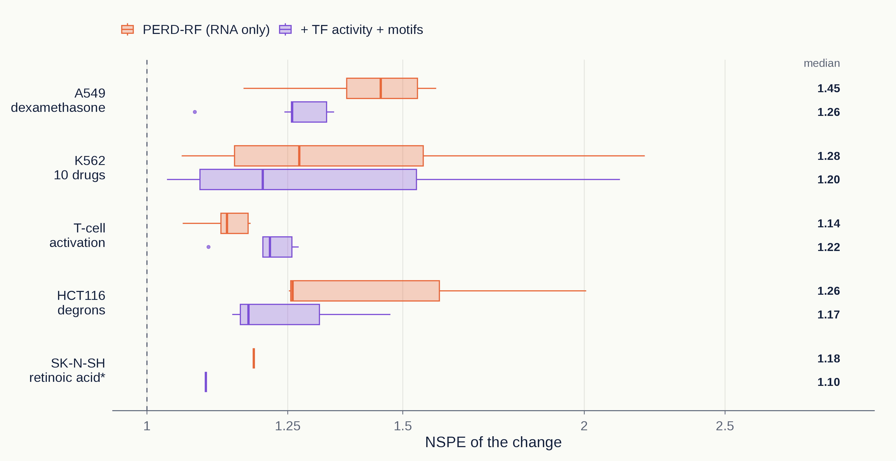

# Abstract

PERD (Wang & Wang, 2024) predicts how open each enhancer is from the RNA levels of its target genes and of the transcription factors (TFs) that bind it. The authors then fed drug-treated RNA profiles into the model and called enhancers whose predicted openness changed "drug-responsive". Those calls were never checked against measured accessibility. I reproduced PERD's random-forest model (PERD-RF) and tested it on 16 perturbations from ENCODE (40 before/after pairs with RNA and accessibility measured on both sides). PERD-RF holds up on tissues it never saw: holding out whole tissue types lowers its median per-enhancer correlation only from 0.50 to 0.46. It also predicts openness before and after treatment well (NSPE 0.31–0.57). But it does not predict the change between them: the error on the change is worse than guessing "no change" in all five datasets (NSPE 1.14–1.45). Adding TF activity inferred from target genes, and motif-based TF inputs, lowers the error on unseen tissues (median NSPE 0.276 → 0.245) but leaves the change error above 1. A new model trained directly on real before/after pairs is the first to beat "no change" (median NSPE 0.94), but a control that only knows each enhancer's starting openness does as well (0.92). RNA tells us where enhancers are open; it does not yet tell us how much a drug changes them.

# 1. Introduction

Most genetic variants linked to drug response sit in non-coding DNA, often in enhancers. To connect a variant to a drug we need to know which enhancers the drug actually opens or closes. Accessibility profiles after drug treatment are rare, while drug-perturbed RNA profiles are plentiful (CMap alone has 1,309 compounds). PERD tries to bridge the two: it learns enhancer openness from RNA in 167 untreated ENCODE samples, then applies the model to RNA measured before and after a drug and calls the enhancers whose predicted openness changes.

The weak point is that the second step was never validated. A model trained on differences *between* cell types may not capture the much smaller differences a drug causes *within* one cell type. I asked four questions:

1. Is PERD a good model of openness in cell types it never saw?
2. Does it predict real drug-induced changes?
3. Do biologically motivated inputs (TF activity, motifs) help?
4. Does training directly on real perturbations help?

# 2. Data

**Training data (untreated).** PERD's training set is ENCODE RNA-seq and DNase-seq for 167 samples, as packaged by BIRD (Zhou et al., 2017): RNA as log2(FPKM + 1) per gene, accessibility as depth-normalized DNase counts in 200 bp bins. Enhancers and their target genes come from GeneHancer v4.4, and TF binding from ENCODE ChIP-seq peak clusters (UCSC `wgEncodeRegTfbsClusteredV3`, used because PERD's own TF file is no longer downloadable). An enhancer's openness is the highest bin that lies fully inside it. I kept every enhancer with at least two input genes (targets plus binding TFs) present in the RNA table: 120,100 enhancers. The paper's stricter filter gave 54,076; I kept the larger set so every analysis covers the same enhancers.

**Test data (perturbations).** I searched all released human ENCODE experiments for cell-and-treatment combinations that have both RNA and accessibility before and after treatment, and kept the five series with replicates in Table 1. For each series I processed the files to exactly PERD's units: the same 200 bp grid, the same "highest bin inside the enhancer" rule, and log2(FPKM + 1) for RNA. ATAC data (K562) were reduced from BAM files to Tn5 cut sites and normalized like BIRD; DNase signal tracks were averaged per bin and rescaled with one constant per dataset so the control's median matches PERD's training median. Within each series I kept only perturbations whose strongest changes replicated across replicates; SK-N-SH could not be checked this way because it has a single untreated sample.

In these series, dexamethasone switches on the glucocorticoid receptor (GR); the K562 drugs include HDAC, BET and p300 inhibitors as well as proteasome and kinase inhibitors; T cells are activated with anti-CD3/CD28 antibodies; in HCT116, auxin removes one tagged protein (BRD4, CTCF or MED14) within hours; and retinoic acid switches on the retinoic-acid receptors.

| Series | Perturbations | Pairs | Assays | In PERD's training set? |
|:--------------------------------------|:--------------|:--------|:------------|:---------------------|
| A549 + dexamethasone, untreated vs 0.5–12 h | 1 | 11 | DNase, RNA | no |
| K562 + 10 drugs, DMSO vs drug at 24 / 48 h | 10 | 20 | ATAC, RNA | untreated K562: yes |
| T-cell activation, resting vs activated (5 T-cell types) | 1 | 5 | DNase, RNA | resting T cells: yes |
| HCT116 degrons, untreated vs 6 h auxin | 3 | 3 | DNase, RNA | no |
| SK-N-SH + retinoic acid, untreated vs 48 h | 1 | 1 | DNase, RNA | treated sample: yes\* |
| **Total** | **16** | **40** | | |

*Table 1. The 16 perturbations (40 before/after pairs) used in every comparison. \*PERD saw the treated SK-N-SH sample during training, so I report it but read it with care.*

# 3. Methods

## 3.1 PERD-RF

For each enhancer, PERD fits its own model: inputs are the RNA levels of the enhancer's GeneHancer target genes and of the TFs with a ChIP-seq peak inside it; the output is the enhancer's openness. The paper describes a random forest as its best model, so I used PERD-RF throughout: scikit-learn random forests with R's `randomForest` defaults (500 trees, one third of the inputs tried at each split, seed 42). To predict a treatment, I predicted openness from the control RNA and from the treated RNA separately and subtracted (treated − control), as PERD does. I never fed an RNA difference into a model trained on absolute openness.

## 3.2 How I scored predictions

The main measure is PERD's own normalized squared prediction error,

$$\mathrm{NSPE} = \frac{\sum (O - \hat{O})^2}{\sum (O - \bar{O})^2},$$

where $O$ is measured and $\hat{O}$ predicted. NSPE = 0 is perfect and NSPE = 1 means no better than predicting the average. For a change (treated − control), the average is close to zero, so NSPE > 1 means the prediction is worse than simply guessing "no change". On unseen tissues I also report PERD's two correlations: per enhancer across samples ("cross-cell") and per sample across enhancers ("cross-enhancer"). For the perturbations I scored PERD's own candidate enhancers (open in more than 100 of the 167 cells, variable, and clearly open in more than 10 cell types; about 95,000) that were open enough to measure (mean openness ≥ 1).

## 3.3 Unseen tissues (question 1)

The paper split the 167 samples at random into 110 for training and 57 for testing, so the same tissue from another donor can sit on both sides. I grouped the 167 samples into their 75 tissue or cell types and ran 5-fold cross-validation by type, so every sample is predicted by models that never saw its tissue. As a reference for PERD's design, I also trained one shared random forest across all enhancers instead of one model per enhancer.

## 3.4 Drug-induced change (question 2)

For each of the 40 pairs I compared predicted and measured openness on three things: before (control), after (treated), and the change (after − before), each as NSPE over the scored enhancers, using the mean over replicates on each side.

## 3.5 Biological inputs (question 3)

PERD uses a TF's mRNA as a proxy for its activity, but many TFs are switched on without changing their mRNA. I added two kinds of input:

- **TF activity.** For each sample, I scored every TF's activity from the RNA of its known target genes (CollecTRI network; univariate linear model as in decoupleR, which I cross-checked against decoupler 2.2.0), with genes scaled to the 167 training samples. Each enhancer gets the activity of the TFs bound in it as extra inputs.
- **Motif-based activity.** For each enhancer I took up to 20 motif families (Vierstra et al., 2020 archetypes) that are unusually dense in its DNA and added the mean activity of each family's TFs.

To separate biology from simply adding inputs, I ran a control: the same TF activity computed from *randomly chosen* target genes. All versions use the same random-forest settings and the same tissue-grouped folds, and are then applied to the 40 pairs.

## 3.6 Training on perturbations (question 4)

The pair model (Figure 1) is one random forest trained on the perturbations themselves. Each training row is one enhancer in one before/after pair. Its 317 inputs describe what the treatment did (TF-activity change × motif density for 191 motif families, TF-activity change × ChIP binding for 117 TFs, and the RNA change of the enhancer's target genes), the enhancer's openness before treatment, and five fixed properties (its mean and spread of openness across ENCODE, its length, and its numbers of target genes and bound TFs). The target is the measured change. I trained on 20,000 random measurable enhancers per pair (chosen without looking at the change), weighted each perturbation equally, and used leave-one-perturbation-out: train on 15 perturbations, predict the 16th, repeat for all 16. The control has the same forest with only the starting openness and the five fixed properties, so it knows nothing about the drug.

# 4. Results

## 4.1 PERD is a good model of openness in unseen tissues

Holding out whole tissues costs PERD-RF little (Figure 2). On the paper's 57 test samples, the median per-enhancer correlation drops from 0.50 to 0.46, the per-sample correlation from 0.87 to 0.85, and the per-sample NSPE rises from 0.26 to 0.30. On the random split my reproduction is in line with, or slightly above, the accuracy the paper reports, and the tissue held-out test shows that this accuracy is not inflated much by same-tissue samples in training. One model per enhancer is clearly better than one shared forest (per-enhancer correlation 0.46 vs 0.26), which supports PERD's design.

## 4.2 PERD knows which enhancers are open, not how much a drug changes them

Before and after treatment, PERD-RF predicts openness well: median NSPE 0.31–0.57 across the five series (Figure 3). The change is a different story. Its NSPE is 1.14–1.45, above 1 in every series, so predicting "no change" would have a smaller error. This holds where PERD saw the untreated cells (K562, T cells) and where it did not (A549, HCT116). The drug barely reorders which enhancers are open, so a model can get both sides right and still miss the small difference between them.

## 4.3 Biological inputs help on unseen tissues, but not with the change

Adding TF activity and motif inputs lowers the error on unseen tissues (Figure 4). The median NSPE per held-out sample goes from 0.276 for PERD-RF to 0.265 with TF activity, 0.249 with motifs and 0.245 with both. Motifs give the clearest gain. TF activity alone is only slightly better than its shuffled control (0.269), so by NSPE most of its gain comes from having extra inputs rather than from the real TF–target links.

On the perturbations, the new inputs lower the change error a little in most series (overall median 1.31 → 1.24), but it stays above 1 everywhere, and in T cells it gets worse (1.14 → 1.22; Figure 5).

## 4.4 Training on real perturbations: better than "no change", but only through the starting state

Over all 16 perturbations, only two models get below 1: the pair model (median 0.94) and the control that only knows starting openness (0.92; Figure 6). Both do it in K562 (0.85 and 0.84), the largest series with 10 drugs in one cell line. Because the control knows nothing about the drug, the improvement comes from the enhancers' starting openness, not from the drug-induced inputs. Training on real perturbations still does not predict how a drug changes enhancer accessibility.

# 5. Discussion

RNA predicts where enhancers are open, but predicting how drugs change them needs more.

**Validation.** PERD predicts where enhancers are open, even in tissues it never saw, but not how much a drug changes them: the change NSPE is above 1 in all five datasets.

**Improvement.** I tried two things: TF activity and motifs as extra inputs, and a new model trained on real before/after pairs.

**Result.** Better inputs lower the error on unseen tissues (0.276 → 0.245) but barely help with the drug-induced change. The pair model is the first to beat "no change" (0.94), but starting openness alone does as well (0.92).

**Limitations.** The perturbation data are few and noisy: 16 perturbations, mostly two replicates per side. Untreated K562, resting T cells and the treated SK-N-SH sample are among PERD's training samples. My code is a Python reproduction of PERD with a substitute TF-binding file, so it is not 100% identical to the published model. Some comparisons were decided after earlier results were known, so I report them as descriptive.

**Next steps.** More replicated perturbation data, and trying different models.

# 6. Code and data

All code is in this repository (branch `submission`). The folder `demo/` holds a small toy dataset and a notebook (`demo/demo.ipynb`) that runs the four analyses end to end in about twelve minutes; its outputs are saved, so it can be read without running it. The scripts in `scripts/` produce the full results, `README.md` lists them in order, and `DATA.md` links every raw source (ENCODE accessions, BIRD, GeneHancer, CollecTRI, motif archetypes).

# References

- Wang, Y. & Wang, Y. Identification of drug responsive enhancers by predicting chromatin accessibility change from perturbed gene expression profiles. *npj Systems Biology and Applications* 10, 62 (2024).
- Zhou, W. et al. Genome-wide prediction of DNase I hypersensitivity using gene expression. *Nature Communications* 8, 1038 (2017).
- Fishilevich, S. et al. GeneHancer: genome-wide integration of enhancers and target genes in GeneCards. *Database* (2017).
- Müller-Dott, S. et al. Expanding the coverage of regulons from high-confidence prior knowledge for accurate estimation of transcription factor activities. *Nucleic Acids Research* 51, 10934–10949 (2023).
- Badia-i-Mompel, P. et al. decoupleR: ensemble of computational methods to infer biological activities from omics data. *Bioinformatics Advances* 2, vbac016 (2022).
- Vierstra, J. et al. Global reference mapping of human transcription factor footprints. *Nature* 583, 729–736 (2020).
- The ENCODE Project Consortium. Expanded encyclopaedias of DNA elements in the human and mouse genomes. *Nature* 583, 699–710 (2020).
